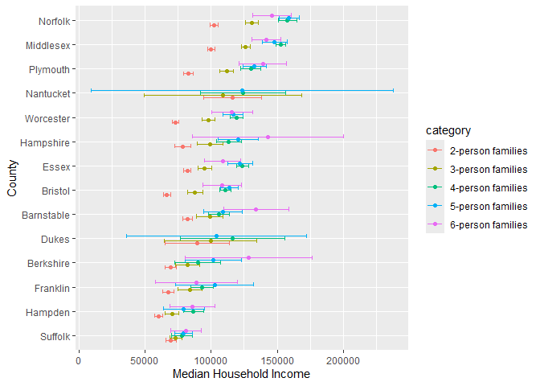
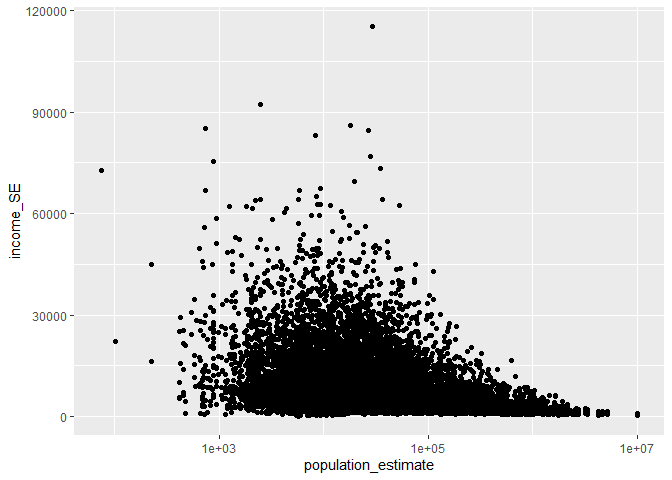
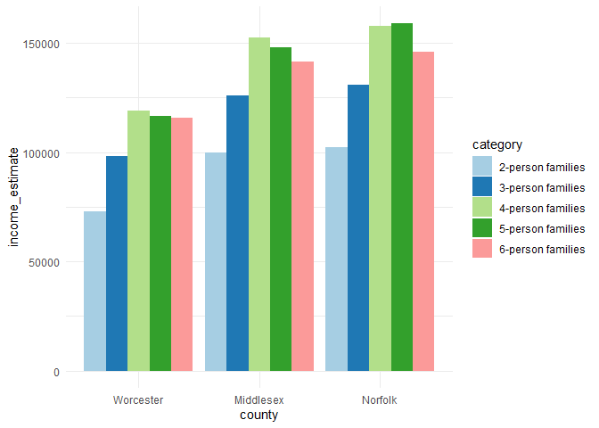

US Income
================
(Your name here)
202X-XX-XX

- [Grading Rubric](#grading-rubric)
  - [Individual](#individual)
  - [Submission](#submission)
- [Setup](#setup)
  - [**q1** Load the population data from c06; simply replace
    `filename_pop`
    below.](#q1-load-the-population-data-from-c06-simply-replace-filename_pop-below)
  - [**q2** Obtain median income data from the Census
    Bureau:](#q2-obtain-median-income-data-from-the-census-bureau)
  - [**q3** Tidy the `df_income` dataset by completing the code below.
    Pivot and rename the columns to arrive at the column names
    `id, geographic_area_name, category, income_estimate, income_moe`.](#q3-tidy-the-df_income-dataset-by-completing-the-code-below-pivot-and-rename-the-columns-to-arrive-at-the-column-names-id-geographic_area_name-category-income_estimate-income_moe)
  - [**q4** Convert the margin of error to standard error. Additionally,
    compute a 99% confidence interval on income, and normalize the
    standard error to `income_CV = income_SE / income_estimate`. Provide
    these columns with the names
    `income_SE, income_lo, income_hi, income_CV`.](#q4-convert-the-margin-of-error-to-standard-error-additionally-compute-a-99-confidence-interval-on-income-and-normalize-the-standard-error-to-income_cv--income_se--income_estimate-provide-these-columns-with-the-names-income_se-income_lo-income_hi-income_cv)
  - [**q5** Join `df_q4` and `df_pop`.](#q5-join-df_q4-and-df_pop)
- [Analysis](#analysis)
  - [**q6** Study the following graph, making sure to note what you can
    *and can’t* conclude based on the estimates and confidence
    intervals. Document your observations below and answer the
    questions.](#q6-study-the-following-graph-making-sure-to-note-what-you-can-and-cant-conclude-based-on-the-estimates-and-confidence-intervals-document-your-observations-below-and-answer-the-questions)
  - [**q7** Plot the standard error against population for all counties.
    Create a visual that effectively highlights the trends in the data.
    Answer the questions under *observations*
    below.](#q7-plot-the-standard-error-against-population-for-all-counties-create-a-visual-that-effectively-highlights-the-trends-in-the-data-answer-the-questions-under-observations-below)
- [Going Further](#going-further)
  - [**q8** Pose your own question about the data. Create a
    visualization (or table) here, and document your
    observations.](#q8-pose-your-own-question-about-the-data-create-a-visualization-or-table-here-and-document-your-observations)
- [References](#references)

*Purpose*: We’ve been learning how to quantify uncertainty in estimates
through the exercises; now its time to put those skills to use studying
real data. In this challenge we’ll use concepts like confidence
intervals to help us make sense of census data.

*Reading*: - [Using ACS Estimates and Margin of
Error](https://www.census.gov/data/academy/webinars/2020/calculating-margins-of-error-acs.html)
(Optional, see the PDF on the page) - [Patterns and Causes of
Uncertainty in the American Community
Survey](https://www.sciencedirect.com/science/article/pii/S0143622813002518?casa_token=VddzQ1-spHMAAAAA:FTq92LXgiPVloJUVjnHs8Ma1HwvPigisAYtzfqaGbbRRwoknNq56Y2IzszmGgIGH4JAPzQN0)
(Optional, particularly the *Uncertainty in surveys* section under the
Introduction.)

<!-- include-rubric -->

# Grading Rubric

<!-- -------------------------------------------------- -->

Unlike exercises, **challenges will be graded**. The following rubrics
define how you will be graded, both on an individual and team basis.

## Individual

<!-- ------------------------- -->

| Category | Needs Improvement | Satisfactory |
|----|----|----|
| Effort | Some task **q**’s left unattempted | All task **q**’s attempted |
| Observed | Did not document observations, or observations incorrect | Documented correct observations based on analysis |
| Supported | Some observations not clearly supported by analysis | All observations clearly supported by analysis (table, graph, etc.) |
| Assessed | Observations include claims not supported by the data, or reflect a level of certainty not warranted by the data | Observations are appropriately qualified by the quality & relevance of the data and (in)conclusiveness of the support |
| Specified | Uses the phrase “more data are necessary” without clarification | Any statement that “more data are necessary” specifies which *specific* data are needed to answer what *specific* question |
| Code Styled | Violations of the [style guide](https://style.tidyverse.org/) hinder readability | Code sufficiently close to the [style guide](https://style.tidyverse.org/) |

## Submission

<!-- ------------------------- -->

Make sure to commit both the challenge report (`report.md` file) and
supporting files (`report_files/` folder) when you are done! Then submit
a link to Canvas. **Your Challenge submission is not complete without
all files uploaded to GitHub.**

# Setup

<!-- ----------------------------------------------------------------------- -->

``` r
library(tidyverse)
```

    ## ── Attaching core tidyverse packages ──────────────────────── tidyverse 2.0.0 ──
    ## ✔ dplyr     1.2.1     ✔ readr     2.2.0
    ## ✔ forcats   1.0.1     ✔ stringr   1.6.0
    ## ✔ ggplot2   4.0.3     ✔ tibble    3.3.1
    ## ✔ lubridate 1.9.5     ✔ tidyr     1.3.2
    ## ✔ purrr     1.2.2     
    ## ── Conflicts ────────────────────────────────────────── tidyverse_conflicts() ──
    ## ✖ dplyr::filter() masks stats::filter()
    ## ✖ dplyr::lag()    masks stats::lag()
    ## ℹ Use the conflicted package (<http://conflicted.r-lib.org/>) to force all conflicts to become errors

``` r
#the probability that the confidence interval contains the value: it's either 0 or 1 because the value is either in the interval or not. 99% confidence is not necessarily a 99% probability that something will happen
#5 samples, compute sample mean and sample sd repeatedly, form confidence interval, every interval either does or does not include true value we're interested in
#confidence refers to theoretical procedure of repeatign sampling many many times and how many times are we going to include the true value 
#wider or narrower confidence intervals are based on the sample drawn, varies from case to case
#randomization used to remove sampling bias
#confounding variables are also hopefully removed with randomization
#really hard to list all the things that are confounding so randomization hopefully takes care of that
#Experimental study extra randomization: randomized assignment --> randomly get split into treatment and control 
#Randomization when drawing a sample --> supports inference: allows us to make statements at a specific confidence level about the population
#Randomization assignment --> supports causality: RCT, finding out what causes what
#how to pick a sample size when we're looking for differences between groups 
#randomly selecting: are we guaraunteed to get an equal number of squares vs triangles --> no 
#how to choose how to gather data really informs what you can do 
#characterize difference between groups: oversample a particularl group --> stratiying the sample
#take some # indiv from triangle and # indiv from square and make their standard error's similar (ex: sigma_sqr/sample_sqr or sigma_tri/sample_tri)
#Making SE's roughly equal, allocating resources to the thing that is more variable to become mroe confident in that quantity --> "greater statistical power" to find differences if they exist
#Assuming that the two groups have the same variability if you're just going off the make the sample sizes equal, weak and fragile rule of thumb 
#how do you balance SE --> you don't know SD until you collect all your data --> infinite statistical regress 
#Go to existing literature, do we tend to see any differences in how variable a population is --> one twice as variable as another, looking for equality, all you need to know is how proportionally different they are, can control the SD more and then allows for the sqrt(sample size) to be more constrained
#Populations are frequently not actually normal 
#Median = Q50% sometimes, not standard greek variable
#CLT will break down quickly if moving to a different statistic
#Bootstrap will not break down --> helper function in c07
#Statistic: summary quantity summarizing a population --> mean, sd computed, have both a population version and a sample version
#Means of different groups: actually studying delta = mu_sqr - mu_tri
#Compute a CI on this delta quantity --> delta_hat = mu_sqrhat - mu_trihat
#Difference can be in the negatives or positive --> include 0 
#CI negative, delta < 0, squares less income than triangles
#"Epistemologically diffuse" what the heck does that even mean --> fancy way of saying bad 
#Confidence interval that includes 0 --> guarunatees that we don't have evidence to support a conclusion that one income of one group is more or less than the other --> might be incentivized for things to come out more one way than another (ex: new treatment vs standard of care)
#Significant difference: confidence interval does not include zero when we are considering two statistics of interests
#Sometimes prefer for things to come out similar --> ex: income, differences in income show differences between groups 
#Generally want CI's to be narrower --> ways to get them narrower?
#One thing has higher SD, put more observational units to stamp down the SE --> pooled standard deviation, scale sd by sample sizes chosen then do renormalization to "put them back together", put more observations into one group because indiv sample sizes are combining --> standardized difference: Cohen's d
#Multiple testing ?????
#two groups "strongly separated" relative to their SD's, how far apart their SD's are d = (mu_sqrhat - mu_trihat) / s, less overalp means huge difference, more overlap means larger difference, may need thousands of samples to get this difference
#Target power: probability that we would actually go out and find the difference in a population
#Significance value = alpha
#Need larger amounts of difference to make it statistically significant --> difference too small then just talk about what kind of conclusions your data can endorse
```

### **q1** Load the population data from c06; simply replace `filename_pop` below.

``` r
## TODO: Give the filename for your copy of Table B01003
filename_pop <- "C:/Users/sjalinous/Data-Science-2026-/data-science-curriculum-build/challenges/ACSDT5Y2018.B01003_2026-10-15T105154/ACSDT5Y2018.B01003-Data.csv"

## NOTE: No need to edit
df_pop <-
  read_csv(
    filename_pop,
    skip = 1,
  ) %>% 
  rename(
    population_estimate = `Estimate!!Total`
  )
```

    ## New names:
    ## Rows: 3220 Columns: 5
    ## ── Column specification
    ## ──────────────────────────────────────────────────────── Delimiter: "," chr
    ## (3): Geography, Geographic Area Name, Margin of Error!!Total dbl (1):
    ## Estimate!!Total lgl (1): ...5
    ## ℹ Use `spec()` to retrieve the full column specification for this data. ℹ
    ## Specify the column types or set `show_col_types = FALSE` to quiet this message.
    ## • `` -> `...5`

``` r
df_pop
```

    ## # A tibble: 3,220 × 5
    ##    Geography   `Geographic Area Name` population_estimate Margin of Error!!Tot…¹
    ##    <chr>       <chr>                                <dbl> <chr>                 
    ##  1 0500000US0… Autauga County, Alaba…               55200 *****                 
    ##  2 0500000US0… Baldwin County, Alaba…              208107 *****                 
    ##  3 0500000US0… Barbour County, Alaba…               25782 *****                 
    ##  4 0500000US0… Bibb County, Alabama                 22527 *****                 
    ##  5 0500000US0… Blount County, Alabama               57645 *****                 
    ##  6 0500000US0… Bullock County, Alaba…               10352 *****                 
    ##  7 0500000US0… Butler County, Alabama               20025 *****                 
    ##  8 0500000US0… Calhoun County, Alaba…              115098 *****                 
    ##  9 0500000US0… Chambers County, Alab…               33826 *****                 
    ## 10 0500000US0… Cherokee County, Alab…               25853 *****                 
    ## # ℹ 3,210 more rows
    ## # ℹ abbreviated name: ¹​`Margin of Error!!Total`
    ## # ℹ 1 more variable: ...5 <lgl>

You might wonder why the `Margin of Error` in the population estimates
is listed as `*****`. From the [documentation (PDF
link)](https://www.google.com/url?sa=t&rct=j&q=&esrc=s&source=web&cd=&cad=rja&uact=8&ved=2ahUKEwj81Omy16TrAhXsguAKHTzKDQEQFjABegQIBxAB&url=https%3A%2F%2Fwww2.census.gov%2Fprograms-surveys%2Facs%2Ftech_docs%2Faccuracy%2FMultiyearACSAccuracyofData2018.pdf%3F&usg=AOvVaw2TOrVuBDlkDI2gde6ugce_)
for the ACS:

> If the margin of error is displayed as ‘\*\*\*\*\*’ (five asterisks),
> the estimate has been controlled to be equal to a fixed value and so
> it has no sampling error. A standard error of zero should be used for
> these controlled estimates when completing calculations, such as those
> in the following section.

This means that for cases listed as `*****` the US Census Bureau
recommends treating the margin of error (and thus standard error) as
zero.

### **q2** Obtain median income data from the Census Bureau:

- `Filter > Topics > Income and Poverty > Income and Poverty`
- `Filter > Geography > County > All counties in United States`
- Look for `Median Income in the Past 12 Months` (Table S1903)
- Download the 2018 5-year ACS estimates; save to your `data` folder and
  add the filename below.

``` r
## TODO: Give the filename for your copy of Table S1903
filename_income <- "C:/Users/sjalinous/Data-Science-2026-/data-science-curriculum-build/challenges/ACSST5Y2018.S1903-Data.csv"

## NOTE: No need to edit
df_income <-
  read_csv(filename_income, skip = 1)
```

    ## New names:
    ## • `` -> `...243`

    ## Warning: One or more parsing issues, call `problems()` on your data frame for details,
    ## e.g.:
    ##   dat <- vroom(...)
    ##   problems(dat)

    ## Rows: 3220 Columns: 243
    ## ── Column specification ────────────────────────────────────────────────────────
    ## Delimiter: ","
    ## chr  (66): Geography, Geographic Area Name, Estimate!!Median income (dollars...
    ## dbl (176): Estimate!!Number!!HOUSEHOLD INCOME BY RACE AND HISPANIC OR LATINO...
    ## lgl   (1): ...243
    ## 
    ## ℹ Use `spec()` to retrieve the full column specification for this data.
    ## ℹ Specify the column types or set `show_col_types = FALSE` to quiet this message.

``` r
df_income
```

    ## # A tibble: 3,220 × 243
    ##    Geography      `Geographic Area Name`   Estimate!!Number!!HOUSEHOLD INCOME …¹
    ##    <chr>          <chr>                                                    <dbl>
    ##  1 0500000US01001 Autauga County, Alabama                                  21115
    ##  2 0500000US01003 Baldwin County, Alabama                                  78622
    ##  3 0500000US01005 Barbour County, Alabama                                   9186
    ##  4 0500000US01007 Bibb County, Alabama                                      6840
    ##  5 0500000US01009 Blount County, Alabama                                   20600
    ##  6 0500000US01011 Bullock County, Alabama                                   3609
    ##  7 0500000US01013 Butler County, Alabama                                    6708
    ##  8 0500000US01015 Calhoun County, Alabama                                  45033
    ##  9 0500000US01017 Chambers County, Alabama                                 13516
    ## 10 0500000US01019 Cherokee County, Alabama                                 10606
    ## # ℹ 3,210 more rows
    ## # ℹ abbreviated name:
    ## #   ¹​`Estimate!!Number!!HOUSEHOLD INCOME BY RACE AND HISPANIC OR LATINO ORIGIN OF HOUSEHOLDER!!Households`
    ## # ℹ 240 more variables:
    ## #   `Margin of Error!!Number MOE!!HOUSEHOLD INCOME BY RACE AND HISPANIC OR LATINO ORIGIN OF HOUSEHOLDER!!Households` <dbl>,
    ## #   `Estimate!!Number!!HOUSEHOLD INCOME BY RACE AND HISPANIC OR LATINO ORIGIN OF HOUSEHOLDER!!Households!!One race--!!White` <dbl>,
    ## #   `Margin of Error!!Number MOE!!HOUSEHOLD INCOME BY RACE AND HISPANIC OR LATINO ORIGIN OF HOUSEHOLDER!!Households!!One race--!!White` <dbl>, …

Use the following test to check that you downloaded the correct file:

``` r
## NOTE: No need to edit, use to check you got the right file.
assertthat::assert_that(
  df_income %>%
    filter(Geography == "0500000US01001") %>%
    pull(`Estimate!!Percent Distribution!!FAMILY INCOME BY FAMILY SIZE!!2-person families`)
  == 45.6
)
```

    ## [1] TRUE

``` r
print("Well done!")
```

    ## [1] "Well done!"

``` r
view(df_income)
```

This dataset is in desperate need of some *tidying*. To simplify the
task, we’ll start by considering the `\\d-person families` columns
first.

### **q3** Tidy the `df_income` dataset by completing the code below. Pivot and rename the columns to arrive at the column names `id, geographic_area_name, category, income_estimate, income_moe`.

*Hint*: You can do this in a single pivot using the `".value"` argument
and a `names_pattern` using capture groups `"()"`. Remember that you can
use an OR operator `|` in a regex to allow for multiple possibilities in
a capture group, for example `"(Estimate|Margin of Error)"`.

``` r
df_q3 <-
  df_income %>%
  select(
    Geography,
    contains("Geographic"),
    # This will select only the numeric d-person family columns;
    # it will ignore the annotation columns
    contains("median") & matches("\\d-person families") & !contains("Annotation of")
  ) %>%
  mutate(across(contains("median"), as.numeric)) %>%
## TODO: Pivot the data, rename the columns
  pivot_longer(
    names_to = c(".value","category"),
    names_pattern = "(Estimate|Margin of Error).*(\\d-person families)",
    cols = -c("Geography", "Geographic Area Name")
  ) %>%
  rename(
    "geographic_area_name" = "Geographic Area Name",
    "income_estimate" = "Estimate",
    "income_moe" = "Margin of Error"
    )
```

    ## Warning: There were 8 warnings in `mutate()`.
    ## The first warning was:
    ## ℹ In argument: `across(contains("median"), as.numeric)`.
    ## Caused by warning:
    ## ! NAs introduced by coercion
    ## ℹ Run `dplyr::last_dplyr_warnings()` to see the 7 remaining warnings.

``` r
df_q3
```

    ## # A tibble: 16,100 × 5
    ##    Geography      geographic_area_name    category    income_estimate income_moe
    ##    <chr>          <chr>                   <chr>                 <dbl>      <dbl>
    ##  1 0500000US01001 Autauga County, Alabama 2-person f…           64947       6663
    ##  2 0500000US01001 Autauga County, Alabama 3-person f…           80172      14181
    ##  3 0500000US01001 Autauga County, Alabama 4-person f…           85455      10692
    ##  4 0500000US01001 Autauga County, Alabama 5-person f…           88601      20739
    ##  5 0500000US01001 Autauga County, Alabama 6-person f…          103787      12387
    ##  6 0500000US01003 Baldwin County, Alabama 2-person f…           63975       2297
    ##  7 0500000US01003 Baldwin County, Alabama 3-person f…           79390       8851
    ##  8 0500000US01003 Baldwin County, Alabama 4-person f…           88458       5199
    ##  9 0500000US01003 Baldwin County, Alabama 5-person f…           91259       7011
    ## 10 0500000US01003 Baldwin County, Alabama 6-person f…           69609      23175
    ## # ℹ 16,090 more rows

Use the following tests to check your work:

``` r
## NOTE: No need to edit
assertthat::assert_that(setequal(
  names(df_q3),
  c("Geography", "geographic_area_name", "category", "income_estimate", "income_moe")
))
```

    ## [1] TRUE

``` r
assertthat::assert_that(
  df_q3 %>%
    filter(Geography == "0500000US01001", category == "2-person families") %>%
    pull(income_moe)
  == 6663
)
```

    ## [1] TRUE

``` r
print("Nice!")
```

    ## [1] "Nice!"

The data gives finite values for the Margin of Error, which is closely
related to the Standard Error. The Census Bureau documentation gives the
following relationship between Margin of Error and Standard Error:

$$\text{MOE} = 1.645 \times \text{SE}.$$

### **q4** Convert the margin of error to standard error. Additionally, compute a 99% confidence interval on income, and normalize the standard error to `income_CV = income_SE / income_estimate`. Provide these columns with the names `income_SE, income_lo, income_hi, income_CV`.

``` r
df_q4 <-
  df_q3 %>%
  mutate(
    income_SE = income_moe / 1.645,
    income_CV = income_SE / income_estimate,
    income_lo = income_estimate - 2.576*income_SE,
    income_hi = income_estimate + 2.576*income_SE
  )
df_q4
```

    ## # A tibble: 16,100 × 9
    ##    Geography  geographic_area_name category income_estimate income_moe income_SE
    ##    <chr>      <chr>                <chr>              <dbl>      <dbl>     <dbl>
    ##  1 0500000US… Autauga County, Ala… 2-perso…           64947       6663     4050.
    ##  2 0500000US… Autauga County, Ala… 3-perso…           80172      14181     8621.
    ##  3 0500000US… Autauga County, Ala… 4-perso…           85455      10692     6500.
    ##  4 0500000US… Autauga County, Ala… 5-perso…           88601      20739    12607.
    ##  5 0500000US… Autauga County, Ala… 6-perso…          103787      12387     7530.
    ##  6 0500000US… Baldwin County, Ala… 2-perso…           63975       2297     1396.
    ##  7 0500000US… Baldwin County, Ala… 3-perso…           79390       8851     5381.
    ##  8 0500000US… Baldwin County, Ala… 4-perso…           88458       5199     3160.
    ##  9 0500000US… Baldwin County, Ala… 5-perso…           91259       7011     4262.
    ## 10 0500000US… Baldwin County, Ala… 6-perso…           69609      23175    14088.
    ## # ℹ 16,090 more rows
    ## # ℹ 3 more variables: income_CV <dbl>, income_lo <dbl>, income_hi <dbl>

``` r
# lo_q1 <- mean(z_q1) - qnorm( 1 - (1 - 0.99) / 2 ) * sd(z_q1) / sqrt(100)
# hi_q1 <- mean(z_q1) + qnorm( 1 - (1 - 0.99) / 2 ) * sd(z_q1) / sqrt(100)
```

Use the following tests to check your work:

``` r
## NOTE: No need to edit
assertthat::assert_that(setequal(
  names(df_q4),
  c("Geography", "geographic_area_name", "category", "income_estimate", "income_moe",
    "income_SE", "income_lo", "income_hi", "income_CV")
))
```

    ## [1] TRUE

``` r
assertthat::assert_that(
  abs(
    df_q4 %>%
    filter(Geography == "0500000US01001", category == "2-person families") %>%
    pull(income_SE) - 4050.456
  ) / 4050.456 < 1e-3
)
```

    ## [1] TRUE

``` r
assertthat::assert_that(
  abs(
    df_q4 %>%
    filter(Geography == "0500000US01001", category == "2-person families") %>%
    pull(income_lo) - 54513.72
  ) / 54513.72 < 1e-3
)
```

    ## [1] TRUE

``` r
assertthat::assert_that(
  abs(
    df_q4 %>%
    filter(Geography == "0500000US01001", category == "2-person families") %>%
    pull(income_hi) - 75380.28
  ) / 75380.28 < 1e-3
)
```

    ## [1] TRUE

``` r
assertthat::assert_that(
  abs(
    df_q4 %>%
    filter(Geography == "0500000US01001", category == "2-person families") %>%
    pull(income_CV) - 0.06236556
  ) / 0.06236556 < 1e-3
)
```

    ## [1] TRUE

``` r
print("Nice!")
```

    ## [1] "Nice!"

One last wrangling step: We need to join the two datasets so we can
compare population with income.

### **q5** Join `df_q4` and `df_pop`.

``` r
## TODO: Join df_q4 and df_pop by the appropriate column

df_data <-
  df_q4 %>%
  left_join(
    df_pop,
    by = "Geography"
  )
df_data
```

    ## # A tibble: 16,100 × 13
    ##    Geography  geographic_area_name category income_estimate income_moe income_SE
    ##    <chr>      <chr>                <chr>              <dbl>      <dbl>     <dbl>
    ##  1 0500000US… Autauga County, Ala… 2-perso…           64947       6663     4050.
    ##  2 0500000US… Autauga County, Ala… 3-perso…           80172      14181     8621.
    ##  3 0500000US… Autauga County, Ala… 4-perso…           85455      10692     6500.
    ##  4 0500000US… Autauga County, Ala… 5-perso…           88601      20739    12607.
    ##  5 0500000US… Autauga County, Ala… 6-perso…          103787      12387     7530.
    ##  6 0500000US… Baldwin County, Ala… 2-perso…           63975       2297     1396.
    ##  7 0500000US… Baldwin County, Ala… 3-perso…           79390       8851     5381.
    ##  8 0500000US… Baldwin County, Ala… 4-perso…           88458       5199     3160.
    ##  9 0500000US… Baldwin County, Ala… 5-perso…           91259       7011     4262.
    ## 10 0500000US… Baldwin County, Ala… 6-perso…           69609      23175    14088.
    ## # ℹ 16,090 more rows
    ## # ℹ 7 more variables: income_CV <dbl>, income_lo <dbl>, income_hi <dbl>,
    ## #   `Geographic Area Name` <chr>, population_estimate <dbl>,
    ## #   `Margin of Error!!Total` <chr>, ...5 <lgl>

# Analysis

<!-- ----------------------------------------------------------------------- -->

We now have both estimates and confidence intervals for
`\\d-person families`. Now we can compare cases with quantified
uncertainties: Let’s practice!

### **q6** Study the following graph, making sure to note what you can *and can’t* conclude based on the estimates and confidence intervals. Document your observations below and answer the questions.

``` r
## NOTE: No need to edit; run and inspect
wid <- 0.5

df_data %>%
  filter(str_detect(geographic_area_name, "Massachusetts")) %>%
  mutate(
    county = str_remove(geographic_area_name, " County,.*$"),
    county = fct_reorder(county, income_estimate)
  ) %>%

  ggplot(aes(county, income_estimate, color = category)) +
  geom_errorbar(
    aes(ymin = income_lo, ymax = income_hi),
    position = position_dodge(width = wid)
  ) +
  geom_point(position = position_dodge(width = wid)) +

  coord_flip() +
  labs(
    x = "County",
    y = "Median Household Income"
  )
```

    ## Warning: There was 1 warning in `mutate()`.
    ## ℹ In argument: `county = fct_reorder(county, income_estimate)`.
    ## Caused by warning:
    ## ! `fct_reorder()` removing 2 missing values.
    ## ℹ Use `.na_rm = TRUE` to silence this message.
    ## ℹ Use `.na_rm = FALSE` to preserve NAs.

    ## Warning: Removed 2 rows containing missing values or values outside the scale range
    ## (`geom_point()`).

<!-- -->

**Observations**:

- Document your observations here.
  - The confidence intervals for the 2-person families are consistently
    very small.
  - Nantucket has an insane confidence intervals for the 5-person
    families. This may be due to the small population due to Nantucket
    being an island.
  - Dukes has a similar issue with the confidence intervals as
    Nantucket, but it is a bit less pronounced and it’s once again
    probably caused by a small island population.
  - The larger the families, the larger the confidence intervals tend to
    be.
  - Shockingly, the households with less people tend to have less median
    income.
- Can you confidently distinguish between household incomes in Suffolk
  county? Why or why not?
  - No because their confidence intervals are all over each other so
    they could all be somewhere else and are too overlapping to be
    distinct.
- Which counties have the widest confidence intervals?
  - Nantucket, Dukes, Hampshire

In the next task you’ll investigate the relationship between population
and uncertainty.

### **q7** Plot the standard error against population for all counties. Create a visual that effectively highlights the trends in the data. Answer the questions under *observations* below.

*Hint*: Remember that standard error is a function of *both* variability
(e.g. variance) and sample size.

``` r
df_data %>%
  ggplot(
    aes(population_estimate, income_SE)
  ) +
  geom_point() +
  scale_x_log10()
```

    ## Warning: Removed 814 rows containing missing values or values outside the scale range
    ## (`geom_point()`).

<!-- -->

**Observations**:

- What *overall* trend do you see between `SE` and population? Why might
  this trend exist?
  - As population increases, standard error becomes more precise. This
    trend might exist because the closer you get to portraying the full
    population in your data, the less error you tend to have.
- What does this *overall* trend tell you about the relative ease of
  studying small vs large counties?
  - It is relatively easier to study larger counties because there are
    more samples available to you, whereas smaller counties it is harder
    to get the same number of samples to be as precise.

# Going Further

<!-- ----------------------------------------------------------------------- -->

Now it’s your turn! You have income data for every county in the United
States: Pose your own question and try to answer it with the data.

### **q8** Pose your own question about the data. Create a visualization (or table) here, and document your observations.

``` r
## TODO: Pose and answer your own question about the data
#amogus drip ඞ
df_data
```

    ## # A tibble: 16,100 × 13
    ##    Geography  geographic_area_name category income_estimate income_moe income_SE
    ##    <chr>      <chr>                <chr>              <dbl>      <dbl>     <dbl>
    ##  1 0500000US… Autauga County, Ala… 2-perso…           64947       6663     4050.
    ##  2 0500000US… Autauga County, Ala… 3-perso…           80172      14181     8621.
    ##  3 0500000US… Autauga County, Ala… 4-perso…           85455      10692     6500.
    ##  4 0500000US… Autauga County, Ala… 5-perso…           88601      20739    12607.
    ##  5 0500000US… Autauga County, Ala… 6-perso…          103787      12387     7530.
    ##  6 0500000US… Baldwin County, Ala… 2-perso…           63975       2297     1396.
    ##  7 0500000US… Baldwin County, Ala… 3-perso…           79390       8851     5381.
    ##  8 0500000US… Baldwin County, Ala… 4-perso…           88458       5199     3160.
    ##  9 0500000US… Baldwin County, Ala… 5-perso…           91259       7011     4262.
    ## 10 0500000US… Baldwin County, Ala… 6-perso…           69609      23175    14088.
    ## # ℹ 16,090 more rows
    ## # ℹ 7 more variables: income_CV <dbl>, income_lo <dbl>, income_hi <dbl>,
    ## #   `Geographic Area Name` <chr>, population_estimate <dbl>,
    ## #   `Margin of Error!!Total` <chr>, ...5 <lgl>

``` r
df_data %>%
  filter(str_detect(geographic_area_name, "Massachusetts")) %>%
  mutate(
    county = str_remove(geographic_area_name, " County,.*$"),
    county = fct_reorder(county, income_estimate)
  ) %>%
  filter(county == "Middlesex" | county == "Norfolk" | county == "Worcester") %>%
  ggplot(
    aes(x = county, y = income_estimate, fill = category)
  ) +
  geom_col(position = "dodge") +
  scale_fill_brewer(
    palette = "Paired"
  ) +
  theme_minimal()
```

    ## Warning: There was 1 warning in `mutate()`.
    ## ℹ In argument: `county = fct_reorder(county, income_estimate)`.
    ## Caused by warning:
    ## ! `fct_reorder()` removing 2 missing values.
    ## ℹ Use `.na_rm = TRUE` to silence this message.
    ## ℹ Use `.na_rm = FALSE` to preserve NAs.

<!-- -->

``` r
  #scale_x_log10() +
  #facet_wrap(~county)
```

**Observations**:

- Norfolk county has the highest income estimate, but by very little
  when compared to Middlesex county. They are pretty similar. Worcester,
  on the other hand, has a lower income estimate overall. I grew up in
  Middlesex county and then we moved to Worcester county after I
  finished high school because it is cheaper, which is corroborated by
  this graph. It also makes sense that Norfolk and Middlesex are
  virtually the same, because I forgot Needham was even in Norfolk
  county and thought it was in Middlesex county because they’re so
  similar. But I would never thing Worcester county is the same because
  there is a distinct difference in that county compared to the other
  two.
- One other curious thing is that in Middlesex and Worcester county,
  4-person families have the largest income, which is surprising because
  you’d think that income would go up with more people in the family.

# References

<!-- ----------------------------------------------------------------------- -->

\[1\] Spielman SE, Folch DC, Nagle NN (2014) Patterns and causes of
uncertainty in the American Community Survey. Applied Geography 46:
147–157. <pmid:25404783>
[link](https://www.sciencedirect.com/science/article/pii/S0143622813002518?casa_token=VddzQ1-spHMAAAAA:FTq92LXgiPVloJUVjnHs8Ma1HwvPigisAYtzfqaGbbRRwoknNqZ6Y2IzszmGgIGH4JAPzQN0)
